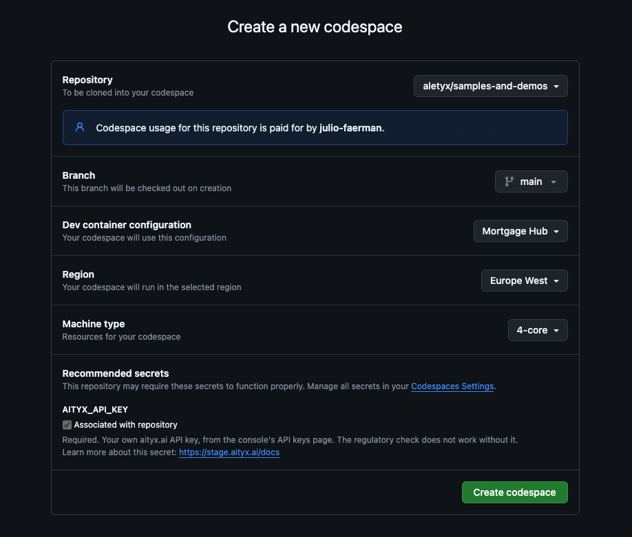

# Mortgage Hub

Mortgage Hub brings a home buyer's mortgage, from application to closing,
into one place. For now the app is a welcome page with a form to request
a mortgage proposal, and a regulatory check that says whether a lender can
process it under current US rules, run by [aityx.ai](https://aityx.ai).

## Technology

| Part | Technology |
|---|---|
| App ([mortgagehub_app/](mortgagehub_app)) | [Flutter](https://flutter.dev) (Dart): web, Android, iOS and Linux from one codebase |
| API ([mortgagehub_api/](mortgagehub_api)) | Dart (`dart:io`): holds the [aityx](https://aityx.ai) key and runs the regulatory check |
| Rules | An [aityx.ai](https://aityx.ai) decision model ([proposal-check.json](mortgagehub_api/models/proposal-check.json)) |
| Dev environment | [Devbox](https://www.jetify.com/devbox) (Nix) in a [Dev Container](https://containers.dev/), process-compose for the services; or [Docker Compose](compose.yaml) |

The toolchain is pinned in [devbox.json](devbox.json) and locked in
[devbox.lock](devbox.lock): Flutter, GNU Make and curl.

## Run it with Docker Compose

With only [Docker](https://docs.docker.com/get-docker/) installed (no
devbox, no Flutter), from this folder:

```bash
docker compose up --build
```

and open http://localhost:8880/app/. [compose.yaml](compose.yaml) builds
and starts two services:

| Service | What |
|---|---|
| `web` | The app's release web build ([docker/web.Dockerfile](docker/web.Dockerfile)), served by nginx under `/app/`, with `/api/` proxied to the API ([docker/nginx.conf](docker/nginx.conf)) |
| `api` | The API compiled to a native executable ([mortgagehub_api/Dockerfile](mortgagehub_api/Dockerfile)); not published, reached only through `web` |

For the regulatory check, copy [.env.example](.env.example) to `.env`
and fill in your [aityx](https://aityx.ai) key, `AITYX_API_KEY` (or
export it). The settings come from your environment, else `.env`, and go
to the API only. The first build takes a few minutes
(it downloads Flutter); later ones reuse Docker's cache. Set
`FLUTTER_WEB_PORT` to change the port; the app is bound to 127.0.0.1
unless you set `MORTGAGEHUB_BIND_HOST=0.0.0.0`. Stop it with
`docker compose down`. Both services have health checks, so
`docker compose ps` shows them `healthy`, and `docker compose up --wait`
returns once they are. Unlike [devbox](#run-it-locally-with-devbox), there is no hot
reload: rebuild after a change.

## Run it locally with devbox

1. Install [Devbox](https://www.jetify.com/devbox/docs/installing_devbox/).
2. For the regulatory check, put your own [aityx](https://aityx.ai) settings in `.env` (see
   [.env.example](.env.example)): `AITYX_API_KEY`, and
   `AITYX_URL=https://console-stage.aityx.ai` for a stage key. In a
   codespace GitHub asks for the key instead; see
   [Run it in a codespace](#run-it-in-a-codespace). Check them
   with `bash scripts/aityx-check.sh`, and the mortgage rules with
   `bash scripts/model-test.sh`.
3. From this folder:

   ```bash
   devbox services up           # add --pcflags "--tui=false" when not in a terminal
   ```

That starts, from [process-compose.yaml](process-compose.yaml):

| URL | What |
|---|---|
| http://localhost:8880/app/ | The Flutter app in web mode ([scripts/flutter-web.sh](scripts/flutter-web.sh)). Press `r` in its terminal to hot reload |
| http://localhost:8881/api/health | The API ([scripts/api.sh](scripts/api.sh)); the web app reaches it as `/api/` on its own origin, through the dev server's proxy |

A `health-check` monitor logs one line every 15 s (set
`HEALTH_CHECK_INTERVAL` to change it): the time, then each check as its
emoji, a short label and ✅ ok / ❌ failed (🤖 [aityx](https://aityx.ai) is ⚪ when the API
has no key):

```
2026-10-13 12:35:54 🌐 Web ✅ · 🔌 API ✅ · 🤖 aityx ✅
```

Stop everything with `devbox services stop`. To run only the app, use
`devbox run web` (set `FLUTTER_WEB_PORT` to change the port); only the
API, `devbox run api` (`API_PORT`).

### Building the binaries

The [Makefile](Makefile) builds release binaries through
[scripts/make.sh](scripts/make.sh):

```bash
make            # every platform this host can build
make web        # mortgagehub_app/build/web/
make android    # mortgagehub_app/build/app/outputs/flutter-apk/app-release.apk
make ios        # mortgagehub_app/build/ios/iphoneos/Runner.app (macOS, unsigned)
make linux      # mortgagehub_app/build/linux/<arch>/release/bundle/ (Linux only)
make clean
```

Pass `MODE=profile` or `MODE=debug` for other build modes, and
`IOS_CODESIGN=1` to sign the iOS build (this needs a signing team in Xcode).
The version is `X.Y.Z`: X and Y from [version.X.txt](version.X.txt) and
[version.Y.txt](version.Y.txt), Z the build time (see
[scripts/version.sh](scripts/version.sh)).

## Run it in a codespace

### 1. Set your [aityx](https://aityx.ai) key — required

The regulatory check runs on [aityx.ai](https://aityx.ai), and it needs an
API key. The key is always **yours**: none ships with this repository and
none is built into the container. Without it the codespace still starts and
the app still opens, but the regulatory check — what this demo exists to
show — cannot run.

Set it once, before launching:

1. Open your [aityx](https://aityx.ai) console's **API keys** page and copy a key.
2. Go to
   [github.com/settings/codespaces](https://github.com/settings/codespaces).
3. Under **Codespaces secrets**, choose **New secret**.
4. Name it exactly `AITYX_API_KEY`, paste the key as the value, and give
   it access to the `aletyx/samples-and-demos` repository.


If you skip this, GitHub asks for the key on the codespace creation page,
because [devcontainer.json](../.devcontainer/Mortgage%20Hub/devcontainer.json)
lists it as a required secret. Either way GitHub keeps it against your
account and passes it to the container as an environment variable: it is
never written to disk there, never committed, and never reaches the Flutter
app.

Nothing else needs setting. The API URL defaults to `https://api.aityx.ai`
and the payment estimate's rate to 6.5%. To change either, put `AITYX_URL`
or `ASSUMED_RATE` in `.env` (see [.env.example](.env.example)) — a stage
key, for instance, works only against `https://console-stage.aityx.ai`.

### 2. Launch it

[](https://codespaces.new/aletyx/samples-and-demos?devcontainer_path=.devcontainer%2FMortgage%20Hub%2Fdevcontainer.json&machine=standardLinux32gb)

That link opens this repository's **Mortgage Hub** dev container on a
4-core machine (16 GB RAM), which is what the Flutter and Nix builds want.
To choose for yourself instead, use *Code → Codespaces → New with
options* and pick **Mortgage Hub** as the dev container configuration —
the repository holds several samples, so the configuration matters.

The creation page should look like this: **Mortgage Hub** as the dev
container configuration, a 4-core machine, and `AITYX_API_KEY` under
*Recommended secrets*, ticked as associated with the repository. If it is
not ticked, the secret does not reach this repository; go back to step 1.



### 3. Run the app

On first start,
[post-create.sh](../.devcontainer/Mortgage%20Hub/post-create.sh) moves to
this folder, downloads the locked Nix store paths and runs `devbox
install`; it also says whether your key arrived. Then, on that and every
later start,
[post-start.sh](../.devcontainer/Mortgage%20Hub/post-start.sh) starts the
services in the background and makes port **8880** public. There is
nothing to run: once the app has compiled, a minute or two on the first
start, open port 8880 from the **Ports** panel (Codespaces may open it
in a browser tab for you). Its bare URL redirects to the app at `/app/`.

Watch the services with `devbox services attach`, restart them with
`devbox services restart`, and stop them with `devbox services stop`.

**If the app doesn't start, send us `MortgageHub/startup.log`.** Every
step of the codespace's start goes there, timestamped: the install, the
services' own output, the port's visibility, and a line saying when the
web app and the API first answered (or, after 15 minutes without, their
state). Open it from the Explorer, or right-click it and choose
**Download**. It holds no secrets: your key and token appear only as
*set* or *not set*.

**Check the port's visibility.** In the **Ports** panel, the
*Visibility* column for 8880 should say **Public**. The codespace sets
it when it starts and again when VS Code attaches, but GitHub does not
always apply it, and an organization can forbid public ports. If it says
**Private**, right-click the port, choose **Port Visibility → Public**
and reload the app. The panel can also lag behind the real setting; from
a terminal, `gh codespace ports -c "$CODESPACE_NAME"` shows it, and
`startup.log` says whether the automatic change worked.

A public port opens for anyone you share the link with — and they run
regulatory checks on your [aityx](https://aityx.ai) key. Set it back to
private in the **Ports** panel if you don't want that. If
`devbox install` fails with HTTP 403, export `GITHUB_TOKEN` (for example
`export GITHUB_TOKEN=$(gh auth token)`) and run it again.

## Run it in a dev container locally

Open the repository root in VS Code and choose **Reopen in Container**,
then **Mortgage Hub**. The dev container lives at the root of the
repository, in [.devcontainer/Mortgage Hub/](../.devcontainer/Mortgage%20Hub),
because that is where GitHub looks for one.

The [Containerfile](../.devcontainer/Mortgage%20Hub/Containerfile) starts
from Microsoft's `ubuntu-24.04` devcontainer base image and installs
pinned, checksum-verified releases of Devbox and Nix.

Codespaces secrets are a GitHub feature, so set the key here by copying
[.env.example](.env.example) to `.env` and filling in `AITYX_API_KEY`. The
scripts read the environment first and fall back to `.env`, so the same
commands work either way.

## Contributing

1. Create a branch from an up-to-date `main`.
2. Make one change per pull request, with its tests. Run `flutter analyze`
   and `flutter test` in `mortgagehub_app/`, and `dart analyze` and
   `dart test` in `mortgagehub_api/`.
3. Update the matching feature spec in [specs/](specs/) and add an entry to
   [specs/requests.md](specs/requests.md).
4. Open a pull request against `main`.

## Learn more

- [specs/](specs/README.md): the specification of every feature.
